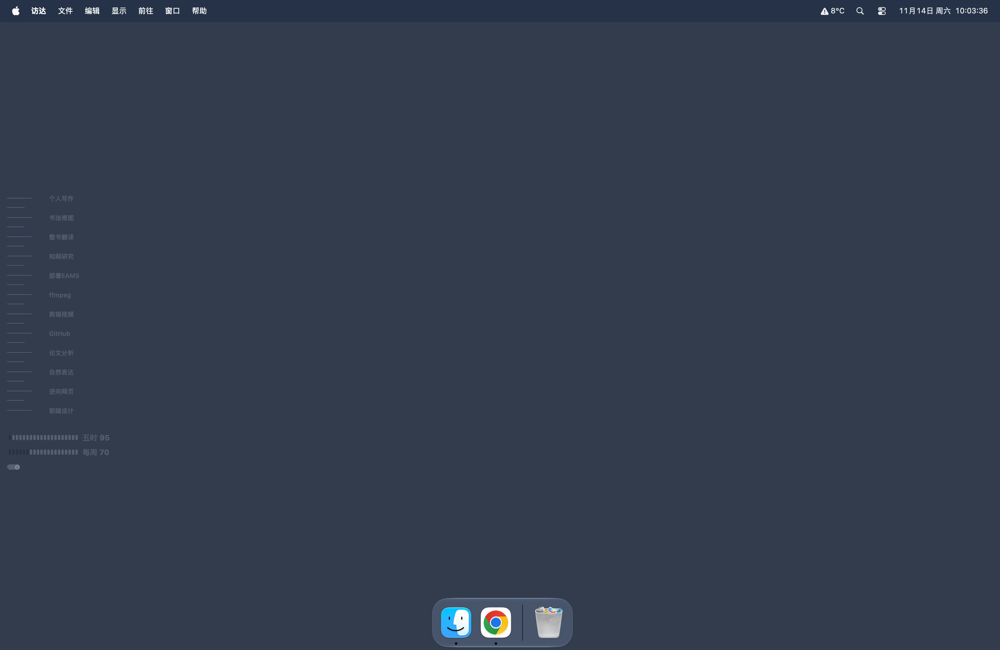
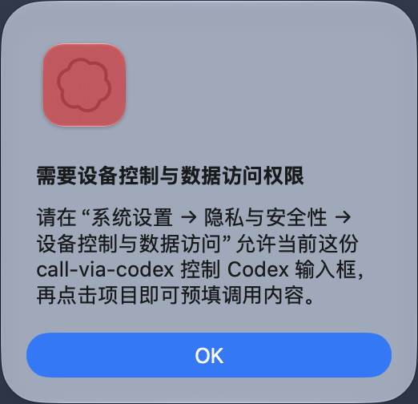

# call via codex

call via codex 是一款 macOS 桌面侧栏，用于快速调用本机已安装的 Codex 技能、插件和命令行工具，也可以执行预先配置的快捷操作。

当前版本：**v1.0.1**。版本更新说明见 [GitHub Releases](https://github.com/wangjiafeng/call-via-codex/releases)。

侧栏还显示 Codex 五小时和每周剩余额度，并提供 Shadowrocket 连接状态按钮。

- 要求 macOS 14 或更高版本，支持 Apple Silicon 与 Intel Mac。
- 应用采用 GPL-3.0-only 许可证，详见 [LICENSE](LICENSE)。
- 发布包使用本地 ad hoc 签名，尚未使用 Developer ID 签名或公证。

## 设置

设置菜单依次为“通用设置”“项目列表”“快捷操作”“侧栏排序”“界面设置”和“关于应用”。

### 通用设置

可设置启动时是否显示设置、是否随系统启动、侧栏位置、显示数量、垂直位置和透明度，也可重新扫描项目与刷新状态。

### 项目列表

分列显示本机已安装的 Codex 技能与插件、命令行工具和应用程序。可以勾选要显示在侧栏中的项目，并设置侧栏显示名称。

### 快捷操作

可以添加、编辑、删除快捷操作，并选择是否显示在桌面侧栏。支持：

- 连接 WebDAV、FTP 等服务器，支持账号和密码；
- 打开网址；
- 打开 app 并执行录制的点击动作；
- 运行 macOS 快捷指令；
- 在终端运行命令；
- 运行 Python 程序。

### 侧栏排序

可把已勾选的项目和已启用的快捷操作放在同一列表中排序。拖动整行即可调整侧栏顺序。

### 界面设置

可以调整侧栏配色、显示名称方式和字体大小，并在右侧预览。使用“恢复默认”还原配色，使用“确认修改”保存调整。

## 授权

首次调用 Codex 或录制 app 点击动作时，macOS 可能会请求辅助功能或自动化权限。请根据系统提示，在“系统设置 → 隐私与安全性”中允许 call via codex 控制相应应用。

## 操作

- **调用项目：** 在侧栏点击已选中的技能、插件、命令行工具或应用程序。
- **执行快捷操作：** 在侧栏点击已启用的快捷操作。app 点击动作可设置启动等待时间；界面加载较慢时可增加等待时间。
- **搜索项目：** 在“项目列表”页面搜索项目并勾选，或修改侧栏显示名称；发现新项目后，在“通用设置”中重新扫描。
- **滚动列表：** 在侧栏列表区域双指上下滚动查看未同时显示的项目。
- **刷新、设置或退出：** 在侧栏空白处双指单击或右键单击，选择相应菜单项。
- **查看 Codex 额度：** 侧栏显示五小时和每周额度剩余比例。
- **控制 Shadowrocket：** 点击侧栏底部按钮切换连接状态。

## v1.0.1 更新说明

1. 修正了一些小错误；
2. 修改了设置界面；
3. 增加从左侧栏打开服务器连接、网址、app 并执行点击动作、macOS 快捷指令、终端命令和 Python 程序的功能。
