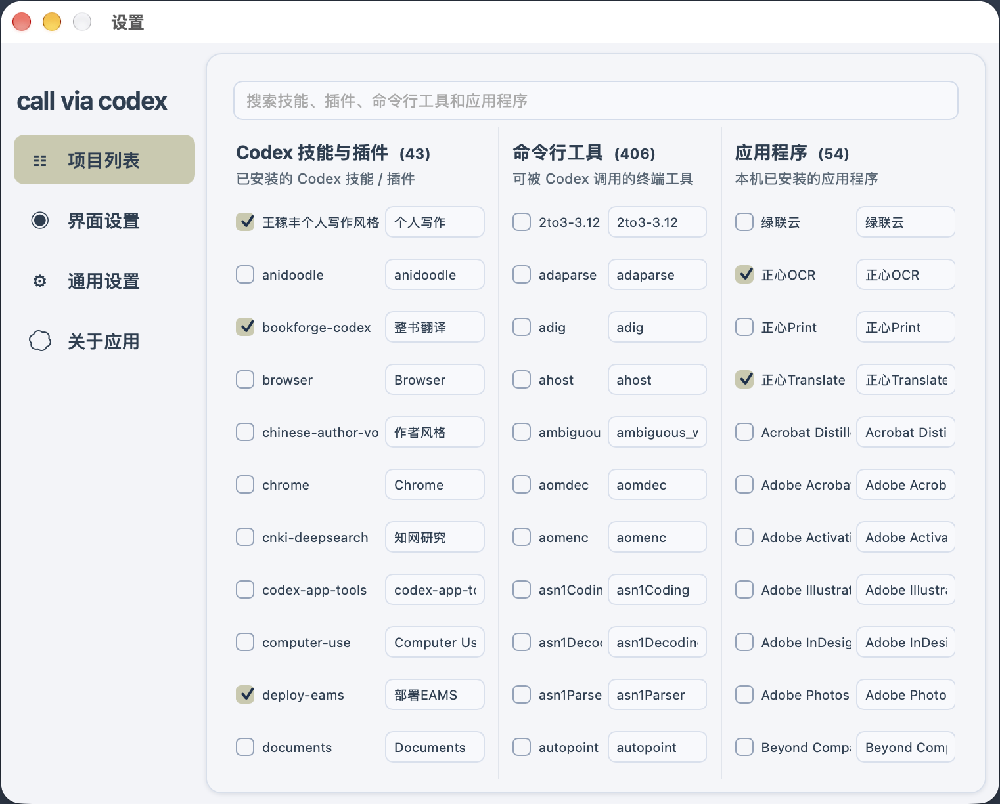
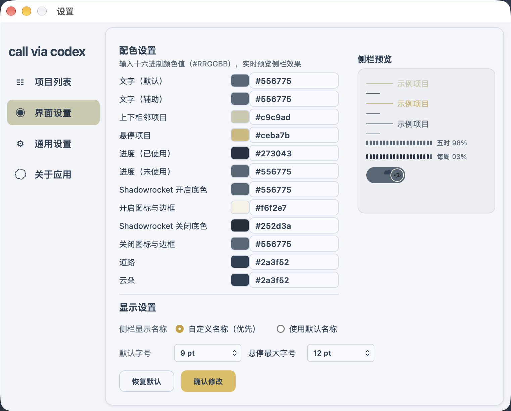
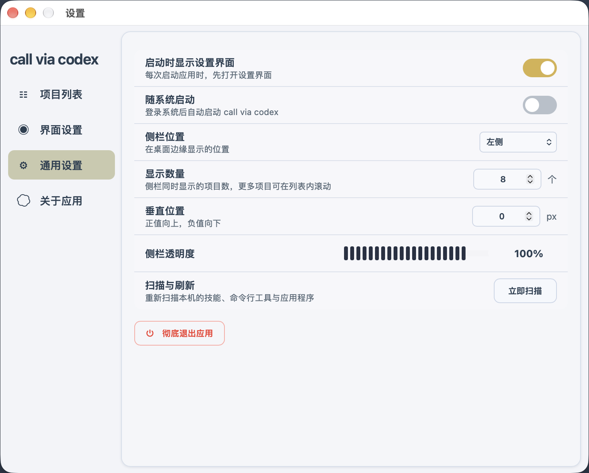
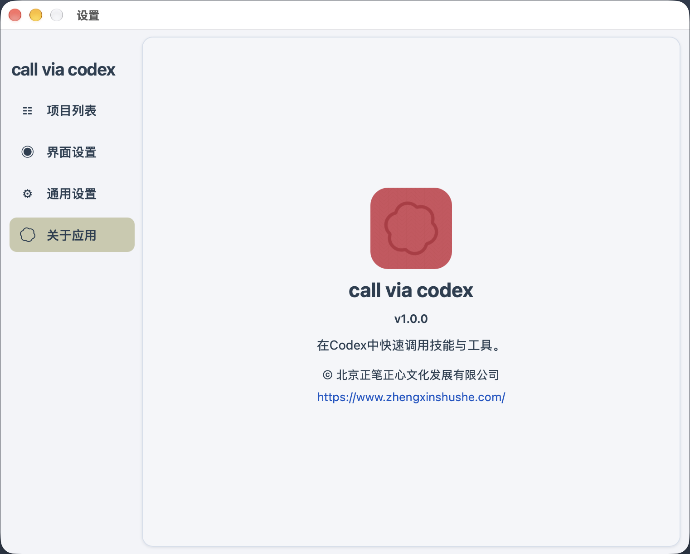
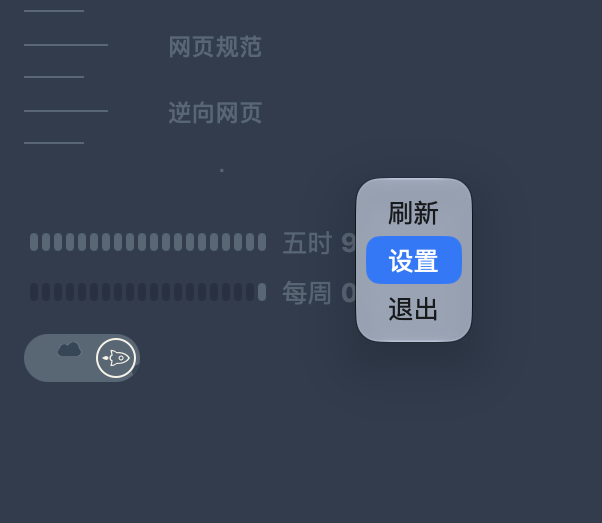

# call via codex

## 1、功能

call via codex 是一款 macOS 桌面侧栏，用于快速调用本机已安装的 Codex 技能与插件、命令行工具和应用程序，点击会打开 Codex 并输入调用技能、插件、命令行工具或程序的代码，再由您补充指令。

call via codex 还显示 Codex 五小时和每周剩余额度，并提供 Shadowrocket 连接状态按钮。

call via codex 要求 macOS 14 或更高版本，支持 Apple Silicon 与 Intel Mac。当前发布包采用本地 ad hoc 签名，尚未使用 Developer ID 签名或公证。

call via codex 采用 GPL-3.0-only 许可证，详见 [LICENSE](LICENSE)。

## 2、设置

设置窗口分为“项目列表”“界面设置”“通用设置”和“关于应用”。

### 项目列表

分三列分别显示本机已安装的技能与插件、命令行工具、应用程序。顶部搜索框可以进行查找。

您可以勾选要显示在侧栏中的项目并在对应输入框中设置侧栏显示名称。

### 界面设置

可以调整侧栏配色、显示名称方式和字体大小并在右侧预览。使用“恢复默认”还原默认配色，使用“确认修改”保存调整。

### 通用设置

可设置启动时是否显示设置、是否随系统启动、侧栏位置、显示数量、垂直位置、侧栏透明度，以及扫描与刷新。
显示数量决定侧栏同时显示的项目数，更多项目可以在列表内双指上下滚动。
垂直位置以像素为单位，正值向上、负值向下。

### 关于应用

显示应用图标、版本、简介、版权信息和官网链接。

## 3、授权

首次在Codex中调用时，macOS 会要求允许 call via codex 控制 Codex 输入框。
请打开“系统设置 → 隐私与安全性 → 设备控制与数据访问”，允许 call via codex。

## 4、操作

- **调用项目：** 在侧栏点击已选中的技能、插件、命令行工具或应用程序，Codex 会打开并出现预填内容。
- **搜索项目：** 在设置的“项目列表”页面输入名称，定位对应项目并勾选或修改侧栏显示名称。如果有新项目，在“通用设置”中点击“立即扫描”即可重新发现。
- **滚动列表：** 在侧栏列表区域双指上下滚动查看未同时显示的项目。
- **刷新、设置或退出：** 在侧栏空白处双指单击或右键单击，选择刷新/设置/退出。
- **查看Codex余额：** 进度条和剩余百分比直接显示五小时剩余额度和本周剩余额度。
- **控制 Shadowrocket：** 点击侧栏底部按钮切换连接状态。

